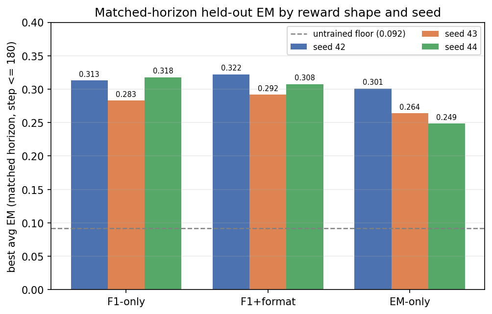
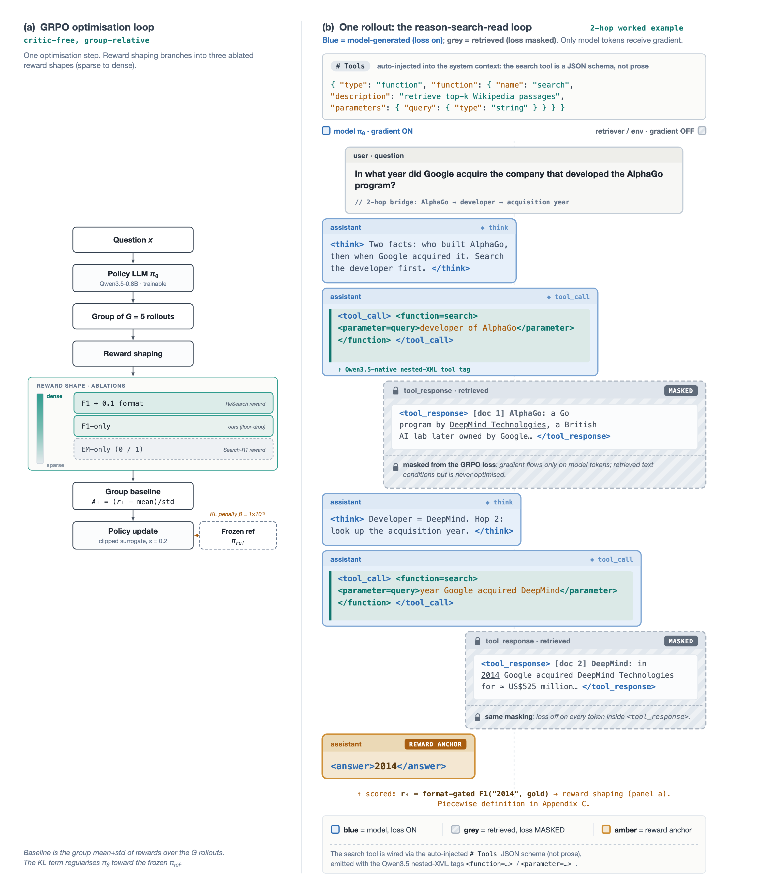

# Reinforcement Learning with Verifiable Rewards for Small Search Agents

[](https://arxiv.org/abs/2609.28765)
[](#checkpoints-and-evaluation-data)

Code, results and checkpoints for the paper by **Gaurisankar Jayadas, Aske Plaat, Álvaro Serra-Gómez and Sandheep P**.

Reinforcement learning with verifiable rewards (RLVR) works well for math and code, where an answer can be checked exactly. We ask whether it also works for open-domain question answering on a small model. We train **Qwen3.5-0.8B** with GRPO and an interleaved Wikipedia search tool on MuSiQue, change only the reward, and evaluate on a seven-benchmark QA suite.

## Key results

- **Small models can learn this.** The best run reaches **0.352** average exact match (EM), up from an untrained **0.092**, a 3.8-fold gain with no distillation step.
- **Reward shape matters.** The exact-match-only reward used by Search-R1 is the worst of the three shapes at every seed when runs are compared at the same training horizon.
- **Large-model recipes do not simply scale down.** Small-model RLVR needs its own reward design.



| Reward shape | Definition | Seed 42 | Seed 43 | Seed 44 | Mean | Range |
|---|---|---:|---:|---:|---:|---:|
| F1+format | Token F1, 0.1 floor, format gate | 0.322 | 0.292 | 0.308 | **0.307** | 0.030 |
| F1-only | Token F1 | 0.313 | 0.283 | 0.318 | **0.305** | 0.035 |
| EM-only | 0/1 exact match | 0.301 | 0.264 | 0.249 | **0.271** | 0.052 |

*Best checkpoint at step 180 or earlier, the longest horizon shared by all nine runs. Average EM across 51,713 rows per checkpoint. The 0.352 best run comes from F1-only seed 44 at step 310.*

Full tables, figures and raw per-checkpoint data are in **[docs/RESULTS.md](docs/RESULTS.md)**.

## How it works

Each question produces a group of five rollouts. The model alternates between reasoning and search calls until it answers, and only its own tokens receive gradient, so retrieved text is masked from the loss. The final answer is scored by one of the three reward shapes, then GRPO updates the policy from the reward differences within the group.

<details>
<summary>Training pipeline diagram</summary>



</details>

## Repository layout

| Path | Contents |
|---|---|
| [`training_m5_1/`](training_m5_1/) | Training setup for the F1-only reward |
| [`training_m5_5/`](training_m5_5/) | Training setup for the F1+format reward |
| [`training_m5_6/`](training_m5_6/) | Training setup for the EM-only reward |
| [`training/`](training/) | Shared training code and the vendored [NeMo-RL](https://github.com/NVIDIA-NeMo/RL) copy the setups above link to |
| [`evaluation_qwen35/`](evaluation_qwen35/) | Evaluation harness for Qwen3.5, built on FlashRAG |
| [`evaluation_search_r1/`](evaluation_search_r1/) | Harness from our earlier Search-R1 baseline reproduction |
| [`local_retriever/`](local_retriever/) | FAISS retriever service over a Wikipedia corpus |
| [`data/`](data/) | Benchmark and training splits, stored with Git LFS |
| [`docs/results/`](docs/results/) | Per-checkpoint evaluation scores and training curves as CSV |
| [`scripts/`](scripts/) | Plotting, score aggregation and checkpoint conversion |

READMEs inside the subfolders began as working notes, so they can include more project detail than this page.

## Reproducing the work

Training used NVIDIA data-center GPUs, and the retriever's default index needs about 16 GB of host RAM. Clone with [Git LFS](https://git-lfs.com) installed.

**1. Start the retriever** on port 3005. [`local_retriever/README.md`](local_retriever/README.md) covers the encoder, corpus and index downloads.

```bash
cd local_retriever
python retriever_serving.py --config retriever_config.yaml --port 3005
```

**2. Train.** Each reward has its own folder with the same commands. W&B credentials go in that folder's `.env`, based on `.env.example`.

```bash
cd training_m5_1
bash setup.sh
python scripts/prep_musique.py
bash scripts/run.sh --mode prod --seed 42
```

The paper's runs were capped at 180, 230 and 312 steps for seeds 42, 43 and 44.

**3. Evaluate** a checkpoint served through an OpenAI-compatible server such as SGLang. Repeat for each benchmark.

```bash
cd evaluation_qwen35
python run_eval.py \
  --config_path flashrag/config/basic_config.yaml \
  --method_name search-r1 \
  --prompt_mode qwen35 \
  --data_dir ../data \
  --dataset_name bamboogle \
  --split test \
  --save_dir ./results/bamboogle \
  --save_note qwen35 \
  --sgl_remote_url 127.0.0.1:3000 \
  --remote_retriever_url 127.0.0.1:3005 \
  --generator_model qwen35_policy \
  --apply_chat True
```

**4. Regenerate the figures** from the published scores. This step needs no GPU, and the figures are written to `docs/figures/`.

```bash
python scripts/plot_heldout.py
```

## Checkpoints and evaluation data

| Reward | Seed 42 | Seed 43 | Seed 44 |
|---|---|---|---|
| F1-only | [m5_1_s42](https://huggingface.co/pantomiman/qwen3.5-0.8b-grpo-musique-m5_1_s42) | [m5_1_s43](https://huggingface.co/pantomiman/qwen3.5-0.8b-grpo-musique-m5_1_s43) | [m5_1_s44](https://huggingface.co/pantomiman/qwen3.5-0.8b-grpo-musique-m5_1_s44) |
| F1+format | [m5_5_s42](https://huggingface.co/pantomiman/qwen3.5-0.8b-grpo-musique-m5_5_s42) | [m5_5_s43](https://huggingface.co/pantomiman/qwen3.5-0.8b-grpo-musique-m5_5_s43) | [m5_5_s44](https://huggingface.co/pantomiman/qwen3.5-0.8b-grpo-musique-m5_5_s44) |
| EM-only | [m5_6_s42](https://huggingface.co/pantomiman/qwen3.5-0.8b-grpo-musique-m5_6_s42) | [m5_6_s43](https://huggingface.co/pantomiman/qwen3.5-0.8b-grpo-musique-m5_6_s43) | [m5_6_s44](https://huggingface.co/pantomiman/qwen3.5-0.8b-grpo-musique-m5_6_s44) |

Evaluation data is on Hugging Face: [reason-over-search-eval-results](https://huggingface.co/datasets/pantomiman/reason-over-search-eval-results) and [reason-over-search-eval-m5](https://huggingface.co/datasets/pantomiman/reason-over-search-eval-m5).

## Citation

```bibtex
@misc{jayadas2026rlvr,
  title         = {Reinforcement Learning with Verifiable Rewards for Small Search Agents},
  author        = {Jayadas, Gaurisankar and Plaat, Aske and Serra-G{\'o}mez, {\'A}lvaro and P, Sandheep},
  year          = {2026},
  eprint        = {2609.28765},
  archivePrefix = {arXiv},
  primaryClass  = {cs.AI},
  url           = {https://arxiv.org/abs/2609.28765}
}
```

## Acknowledgements

This work builds on [Search-R1](https://github.com/PeterGriffinJin/Search-R1), [ReSearch](https://arxiv.org/abs/2503.19470), [NeMo-RL](https://github.com/NVIDIA-NeMo/RL) and FlashRAG.

## License

Original code is released under the [Apache License 2.0](LICENSE). Third-party components, datasets and base model weights keep their own terms; see [THIRD_PARTY_NOTICES.md](THIRD_PARTY_NOTICES.md).
