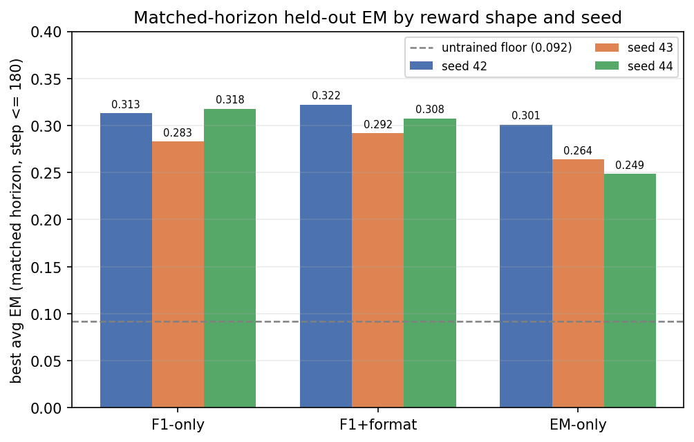

# Results

Full results for [Reinforcement Learning with Verifiable Rewards for Small Search Agents](https://arxiv.org/abs/2609.28765). Nine GRPO runs train Qwen3.5-0.8B on MuSiQue, using three reward shapes and three seeds, and everything else stays fixed.

## Setup

- **Evaluation:** greedy decoding on seven benchmarks, 51,713 rows per checkpoint. Average scores are the macro-average across benchmarks.
- **Benchmarks:** Natural Questions, TriviaQA, PopQA, HotpotQA, Bamboogle, 2WikiMultiHopQA and MuSiQue. MuSiQue is the training set, so it is in-distribution; the other six are held out.
- **Untrained floor:** 0.092 average EM, using the same prompt and decoding.
- **Training length:** one epoch of MuSiQue is about 312 steps. Seeds 42, 43 and 44 were capped at 180, 230 and 312 steps, with checkpoints every 10 steps, up to step 310.

| Reward shape | Definition |
|---|---|
| F1-only | Token-level F1 on the `<answer>` content |
| F1+format | Token-level F1 with a 0.1 floor and a format gate |
| EM-only | 0/1 exact match, the Search-R1 reward |

## Average exact match

**Matched horizon.** Best checkpoint at step 180 or earlier, the longest horizon shared by all nine runs. This is the fairest comparison across seeds.

| Reward shape | Seed 42 | Seed 43 | Seed 44 | Mean | Range |
|---|---:|---:|---:|---:|---:|
| F1+format | 0.322 | 0.292 | 0.308 | **0.307** | 0.030 |
| F1-only | 0.313 | 0.283 | 0.318 | **0.305** | 0.035 |
| EM-only | 0.301 | 0.264 | 0.249 | **0.271** | 0.052 |

**Seed horizon.** Best checkpoint within each seed's own length. Seeds with longer runs have had more training, so compare across rows within a seed column.

| Reward shape | Seed 42 (≤180) | Seed 43 (≤230) | Seed 44 (≤310) | Mean | Range |
|---|---:|---:|---:|---:|---:|
| F1-only | 0.313 | 0.291 | **0.352** | 0.318 | 0.061 |
| F1+format | 0.322 | 0.313 | 0.309 | 0.315 | 0.013 |
| EM-only | 0.301 | 0.264 | 0.318 | 0.294 | 0.054 |

## Exact match by benchmark

At each run's seed-horizon best checkpoint.

| Run | NQ | TriviaQA | PopQA | HotpotQA | 2Wiki | MuSiQue | Bamboogle | Avg EM (step) |
|---|---:|---:|---:|---:|---:|---:|---:|---:|
| F1-only s42 | 0.301 | 0.492 | 0.319 | 0.309 | 0.287 | 0.130 | 0.352 | 0.313 (110) |
| F1-only s43 | 0.301 | 0.489 | 0.321 | 0.259 | 0.274 | 0.093 | 0.296 | 0.291 (210) |
| F1-only s44 | 0.363 | 0.531 | 0.370 | 0.359 | 0.285 | 0.161 | 0.392 | **0.352 (310)** |
| F1+format s42 | 0.319 | 0.500 | 0.335 | 0.311 | 0.313 | 0.117 | 0.360 | 0.322 (100) |
| F1+format s43 | 0.335 | 0.533 | 0.352 | 0.322 | 0.296 | 0.092 | 0.264 | 0.313 (210) |
| F1+format s44 | 0.310 | 0.521 | 0.340 | 0.307 | 0.278 | 0.121 | 0.288 | 0.309 (270) |
| EM-only s42 | 0.314 | 0.492 | 0.342 | 0.306 | 0.238 | 0.103 | 0.312 | 0.301 (170) |
| EM-only s43 | 0.289 | 0.479 | 0.321 | 0.243 | 0.236 | 0.071 | 0.208 | 0.264 (120) |
| EM-only s44 | 0.343 | 0.524 | 0.383 | 0.315 | 0.283 | 0.110 | 0.264 | 0.318 (310) |

## Other metrics

**Average token F1** at the matched horizon, using each run's best-F1 checkpoint.

| Reward shape | Seed 42 | Seed 43 | Seed 44 | Mean | Range |
|---|---:|---:|---:|---:|---:|
| F1-only | 0.402 | 0.369 | 0.407 | 0.393 | 0.038 |
| F1+format | 0.413 | 0.370 | 0.390 | 0.391 | 0.043 |
| EM-only | 0.368 | 0.333 | 0.319 | 0.340 | 0.049 |

**Substring-cover accuracy** at each run's seed-horizon best-EM checkpoint.

| Reward shape | Seed 42 | Seed 43 | Seed 44 | Mean |
|---|---:|---:|---:|---:|
| F1-only | 0.394 | 0.355 | 0.397 | 0.382 |
| F1+format | 0.378 | 0.359 | 0.355 | 0.364 |
| EM-only | 0.334 | 0.293 | 0.340 | 0.323 |

## Raw data

Every table above can be recomputed from the CSVs in [`results/`](results/).

| Reward shape | Seed 42 | Seed 43 | Seed 44 | Training curves |
|---|---|---|---|---|
| F1-only | `m9_m5_1_s42.csv` | `m9_5_m5_1_s43.csv` | `m9_5_m5_1_s44.csv` | `train_m5_1_s{42,43,44}.csv` |
| F1+format | `m9_1_m5_5_s42.csv` | `m9_5_m5_5_s43.csv` | `m9_5_m5_5_s44.csv` | `train_m5_5_s{42,43,44}.csv` |
| EM-only | `m9_2_m5_6_s42.csv` | `m9_5_m5_6_s43.csv` | `m9_5_m5_6_s44.csv` | `train_m5_6_s{42,43,44}.csv` |

Evaluation CSVs have one row per checkpoint, with `step` and `<benchmark>_em`, `<benchmark>_f1` and `<benchmark>_acc` columns.
